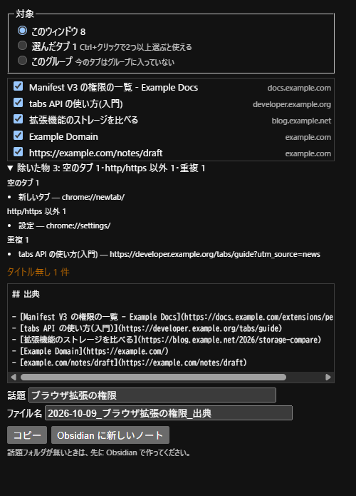
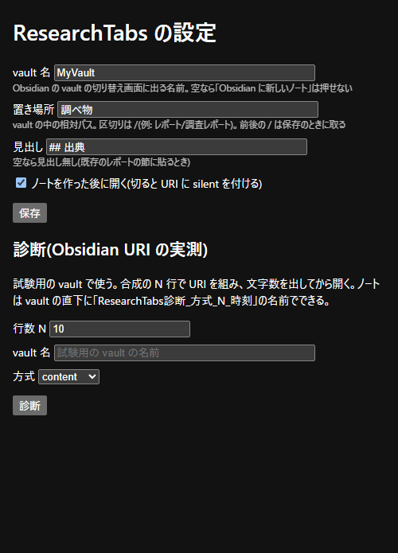

# ResearchTabs

調べ物で開いたタブを、出典の一覧(Markdown)にまとめる Chrome 拡張です。できた一覧はクリップボードにコピーするか、Obsidian の新しいノートにします。

- ページの中身は読みません。使うのはタブの **URL とタイトルだけ** です。
- タブを閉じたり動かしたりしません。
- タブの URL とタイトルは保存しません(保存するのは設定だけです)。

Obsidian の非公式の拡張です。Obsidian とは関係ありません。

## 主な機能

- **対象の選び方**: 「このウィンドウ」「選んだタブ」(Ctrl+クリックで 2 つ以上選んだとき)「このグループ」(タブグループ)から選びます。2 つ以上選んでから開くと、初めから「選んだタブ」になります。
- **除く物**: 空のタブ・`http`/`https` 以外(`chrome://` など)・同じ URL の 2 つ目を自動で除き、理由ごとの件数と中身を見せます。一覧のチェックを外せば、個別に除くこともできます。
- **出典行の書式**: `- [タイトル](URL)` の形です。タイトルの `[` `]` などは逃がし、URL の `utm_*` は消します。タイトルの無いページは「ホスト名+パス」を題にして、「タイトル無し n 件」と知らせます。書式は姉妹の拡張 SourceStamp と同じです(下の「SourceStamp の書式の写し」)。
- **コピー**: 見出し(既定は `## 出典`)と出典行をクリップボードにコピーします。
- **Obsidian に新しいノート**: `<置き場所>/<話題>/<日付>_<話題>_出典` のノートを作ります。中身はクリップボード経由で渡します(Obsidian URI の `new` と `clipboard`)。そのため、**送るとクリップボードの中身は出典の一覧に置き換わります**。上書き・追記の指定は付けません。話題のフォルダが無いときは、先に Obsidian で作ってください。
- **設定のページ**: vault 名・置き場所・見出し・作った後にノートを開くか、を変えられます。Obsidian URI の長さを試す「診断」もあります(試験用の vault で使ってください)。

## 画面

popup(見本のタブ 8 つを開いたところ。空のタブ・`chrome://`・重複の 3 つが除かれている):



設定のページ:



## 動作環境

- Chrome 153 以降(パソコン版)
- 「Obsidian に新しいノート」を使うなら、Obsidian のデスクトップ版(`obsidian://` を開けること)
- 権限は 2 つだけです。

  | 権限 | 理由 |
  |---|---|
  | `tabs` | 今のタブ以外のタブの URL とタイトルを読むため(Chrome の表示は「閲覧履歴の読み取り」) |
  | `storage` | 設定(vault 名・置き場所・見出し・開くか・前回の話題)を保存するため |

- `host_permissions`・content script・service worker はありません。
- **通信はしません**。外へ渡すのは、ボタンを押したときの `obsidian://` の呼び出し(手元の Obsidian へ)だけです。

## 入れ方

1. このリポジトリをダウンロードして展開します。
2. `chrome://extensions` を開き、「デベロッパー モード」を ON にします。
3. 「パッケージ化されていない拡張機能を読み込む」で、展開したフォルダを選びます。
4. **Obsidian に送るなら、設定のページ(アイコンを右クリック →「オプション」)で「vault 名」を自分の vault の名前にします**(初期値は作者の vault の名前です)。置き場所(初期値 `レポート/調査レポート`)も自分の vault に合わせてください。

ビルドはありません。ファイルをそのまま読み込みます。

## テスト

Node.js 22 以降で、このフォルダから:

```
node --test test/index.js
```

依存パッケージはありません。`test/index.js` は全部のテストを読み込むだけの入口です。

## SourceStamp の書式の写し

出典行は、姉妹の拡張 SourceStamp の `format.js` を改変せずに写した `lib/sourcestamp/format.js` で作ります(`lib/format.js` はそれを呼ぶだけです)。SourceStamp の書式が変わったら、写し直してハッシュを合わせます。

SourceStamp のリポジトリをこのリポジトリと同じ階層に置いて、このフォルダから:

```powershell
Copy-Item ..\sourcestamp\format.js .\lib\sourcestamp\format.js
Get-FileHash -Algorithm SHA256 ..\sourcestamp\format.js, .\lib\sourcestamp\format.js
```

2 つの値が同じことを見てから、`test/format.test.js` の `SOURCESTAMP_SHA256` を新しい値(小文字)に変え、テストを回します。写したファイルをエディタで開いて保存し直さないでください(改行が変わるとハッシュが合わなくなります)。

## ライセンス

[MIT](LICENSE)

## 開発状況

v0.1.0 の段階です。窓なしの Chrome での読み込みとテストは通っていますが、普段の Chrome での手触り(クリップボードへの書き込み、`obsidian://` でのノートの作成、タブグループと複数選択)はまだ確かめていません。
